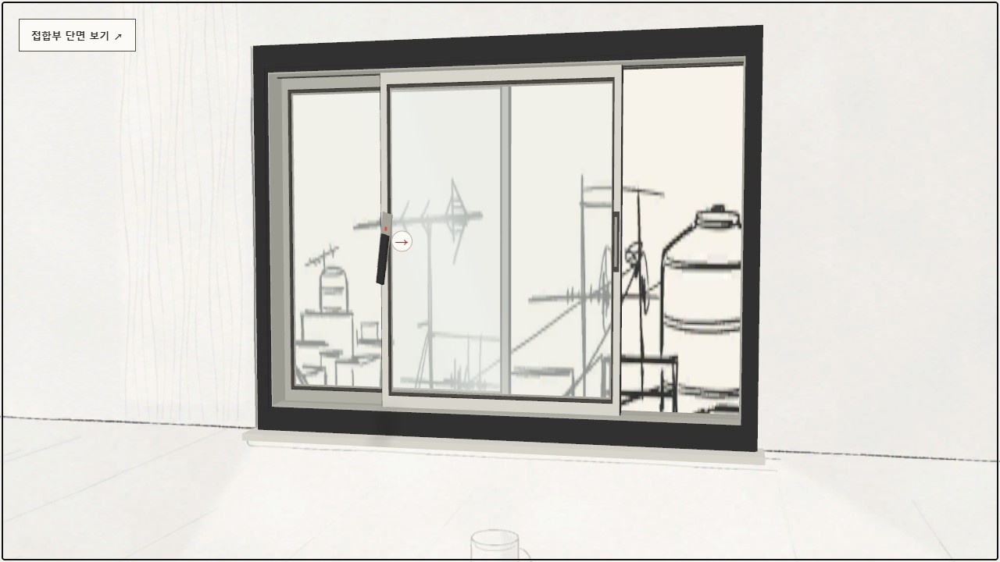
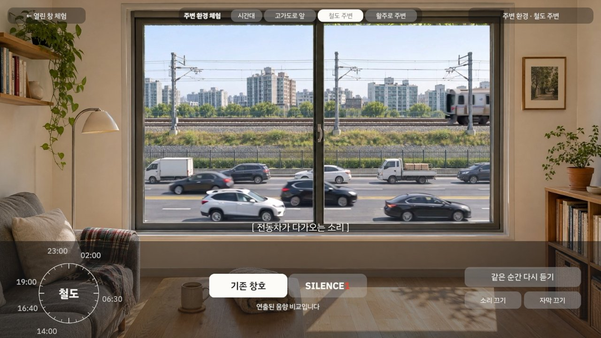

# SILENCE1 Interactive

방음 슬라이딩 창호 **SILENCE1**을 직접 밀어 보고 들어 보는 Unity 인터랙티브입니다.
창을 닫을수록 바깥 소리가 어떻게 줄어드는지, 하루 중 언제 창 앞을 무엇이 지나가는지를 보여 줍니다.

| 체험 | 실행 방법 | 내용 |
|---|---|---|
| **열린 창 체험** | 브라우저에서 바로 실행 | 창짝을 밀어 닫고, 접합부 단면에서 기밀재가 맞닿는 순간을 봅니다 |
| **하루의 방문** | Windows 실행 파일 다운로드 | 여섯 시간대와 세 가지 주변 환경에서 기존 창호와 SILENCE1을 번갈아 듣습니다 |

---

## ▶ 브라우저에서 실행하기 — 열린 창 체험

[](https://edwardh-jedi.github.io/SILENCE1-Interactive/)

**[여기를 눌러 실행 →](https://edwardh-jedi.github.io/SILENCE1-Interactive/)**

- WebGL 2를 지원하는 데스크톱 브라우저(Chrome, Edge, Firefox, Safari)에서 열어 주세요. 처음 열 때 약 47MB를 받습니다.
- 브라우저 정책 때문에 소리는 화면을 처음 누른 뒤부터 나요.

**조작법**

| 입력 | 동작 |
|---|---|
| 앞 창짝 손잡이를 좌우로 드래그 | 창 열기 · 닫기. 닫힐수록 바깥 소리의 음량과 고음이 줄고, 완전히 닫히면 잠금음이 납니다 |
| `←` / `→` | 창을 조금씩 열기 · 닫기 |
| **접합부 단면 보기** 버튼 또는 `V` | 실내 시점과 접합부 단면 시점 전환. 단면에서는 붉은 기밀재가 고정창에 닿는지 보입니다 |

---

## ⬇ Windows에서 실행하기 — 하루의 방문

[](https://github.com/EdwardH-jedi/SILENCE1-Interactive/releases/latest)

1. [Releases](https://github.com/EdwardH-jedi/SILENCE1-Interactive/releases/latest)에서 **`SILENCE1-Visit-Windows.zip`**(약 160MB)을 받습니다.
2. 압축을 모두 푼 뒤 **`SILENCE1 Visit.exe`**를 실행합니다. 압축을 푼 폴더 안의 파일을 함께 두어야 실행됩니다.
3. 서명되지 않은 실행 파일이라 "Windows의 PC 보호" 창이 뜰 수 있습니다. **추가 정보 → 실행**을 누르세요.

Windows 10/11 64비트에서 실행되고, 헤드폰이나 스피커로 들으면 차이가 잘 들립니다.

**장면**

- 시간대: 02:00 배달 스쿠터 · 06:30 첫 버스 · 14:00 초등학생 하굣길 · 16:40 중학생 하굣길 · 19:00 직장인 귀갓길 · 23:00 가게 문 닫는 시간
- 주변 환경: 고가도로 앞 · 철도 주변 · 활주로 주변

화면의 **기존 창호 / SILENCE1** 비교는 연출된 음향입니다. 측정값을 재생하는 것이 아닙니다.

**조작법**

| 입력 | 동작 |
|---|---|
| 시계 다이얼 드래그 · 위쪽 탭 클릭 | 시간대 · 주변 환경 고르기 |
| `A` / `S` | 기존 창호 / SILENCE1로 바꿔 듣기 |
| `R` | 같은 순간 다시 듣기 |
| `PageUp` / `PageDown` | 이전 · 다음 시간대 |
| `M` | 소리 끄기 · 켜기 |
| `C` | 자막 끄기 · 켜기 |
| `Tab` / `Shift+Tab` | 버튼 사이 이동 |
| `Esc` | 열린 창 체험으로 이동 |

---

## Unity에서 열기

- **Unity 6000.6.10f1** (URP). Unity Hub에서 이 폴더를 *Add project from disk*로 추가합니다.
- 웹 빌드에는 **WebGL Build Support**, Windows 빌드에는 **Windows Build Support** 모듈이 필요합니다.

| 씬 | 내용 |
|---|---|
| `Assets/Scenes/Silence1Demo.unity` | 열린 창 체험 (슬라이딩 창 + 접합부 단면) |
| `Assets/Scenes/Silence1Visit.unity` | 하루의 방문 (시간대 영상 · 음향 비교) |

상단 메뉴 **SILENCE1**에서 씬을 다시 만들거나 빌드합니다.

| 메뉴 | 하는 일 |
|---|---|
| Create demo scene · Create visit scene | 에셋으로 씬을 다시 구성 |
| Install window section | 창 접합부 단면을 데모 씬에 붙임 |
| Build web experience | WebGL 빌드. 결과물은 이 저장소 밖 `../silence1-film/public/experience`에 생깁니다 |
| Build Windows visit | `Build/Visit/SILENCE1 Visit.exe` 생성 |

```
Assets/
├─ Silence1/Scripts/        SlidingWindow.cs, WindowSection.cs — 창 드래그 · 소리 · 단면
├─ Silence1/Visit/Scripts/  NightVisit.cs, TimeDial.cs, VisitEntry.cs — 하루의 방문
├─ Silence1/Editor/         DemoBuilder.cs, WindowSectionBuilder.cs
├─ Silence1/Visit/Editor/   VisitBuilder.cs — 시간대별 자막 · 타이밍
├─ Plugins/WebGL/           SilenceWindow.jslib — Unity → 웹 페이지 이벤트
└─ WebGLTemplates/Silence1/ 웹 빌드용 HTML 템플릿 (드래그 · 키보드 입력)
```

브라우저 실행본은 [`gh-pages`](https://github.com/EdwardH-jedi/SILENCE1-Interactive/tree/gh-pages) 브랜치에 있습니다.
